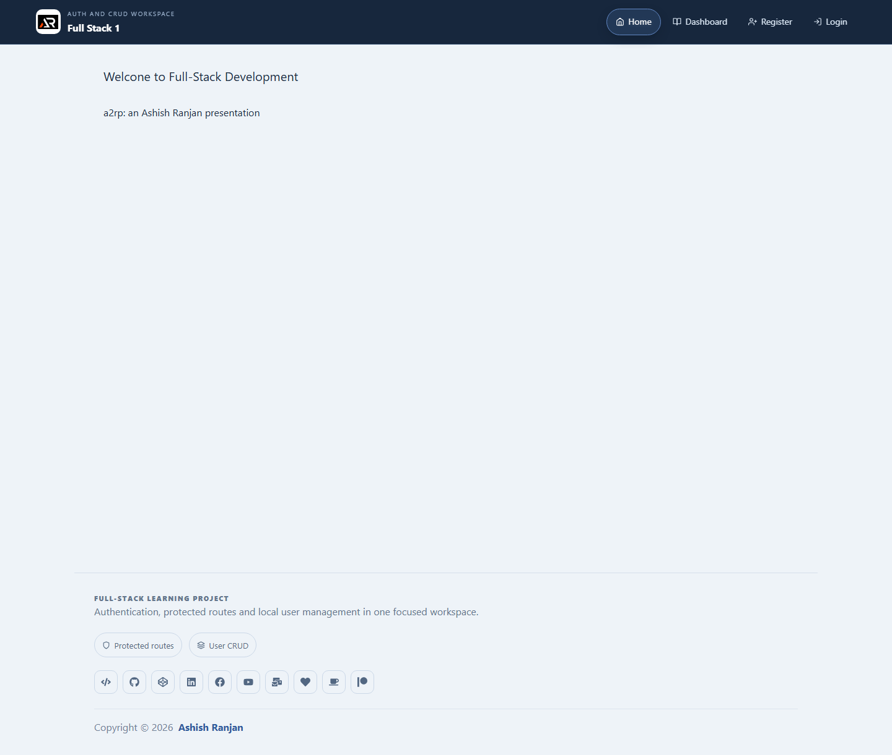

# MERN Full Stack 1

An admin-authenticated MERN workspace for managing user records. The React dashboard supports persistent add, edit, delete, search, sorting, and refresh operations against a MongoDB-backed Express API.



## Features

- Admin accounts with bcryptjs password hashing and HttpOnly JWT session cookies
- Registration protected by a server-side admin enrollment key
- Protected admin routes and API-backed user management
- Validated user create, read, update, and delete endpoints
- Search and sort controls in a responsive React dashboard
- Exact-origin CORS configuration and bounded JSON request bodies

## Requirements

- Node.js 18 or newer
- MongoDB connection string

## Run locally

1. Configure the API from the repository root:

   ```powershell
   Copy-Item .env.example .env
   ```

   Set `MONGODB_URI`, then replace both sample secrets with random values of at least 32 bytes. You can generate them with Node.js:

   ```powershell
   node -e "console.log(require('crypto').randomBytes(32).toString('hex'))"
   ```

   Install dependencies and start the API:

   ```bash
   npm install
   npm start
   ```

   The API listens on `http://localhost:1198` by default.

2. In a second terminal, configure and start the React client:

   ```powershell
   cd frontend
   Copy-Item .env.example .env
   npm install
   npm start
   ```

   The client runs at `http://localhost:3000` and sends credentialed requests to the API.

## Environment variables

| Variable | Purpose |
| --- | --- |
| `PORT` | API port; defaults to `1198` |
| `NODE_ENV` | Set to `production` when deployed |
| `MONGODB_URI` | MongoDB connection string |
| `TOKEN_KEY` | JWT signing secret; at least 32 bytes |
| `ADMIN_REGISTRATION_KEY` | Secret required to create admin accounts; at least 32 bytes |
| `CLIENT_ORIGIN` | Exact comma-separated frontend origins allowed by CORS |
| `COOKIE_SAME_SITE` | `strict` by default; use `none` only for cross-site HTTPS deployments |
| `REACT_APP_API_URL` | API origin for the client; defaults to `http://localhost:1198` |

Keep `.env` files private. Production deployments need HTTPS, an exact `CLIENT_ORIGIN`, and `COOKIE_SAME_SITE=none` when the frontend and API are on different sites.

## API routes

| Method | Route | Access | Description |
| --- | --- | --- | --- |
| `POST` | `/api/v1/admin/register` | Enrollment key | Create an admin and start a session |
| `POST` | `/api/v1/admin/login` | Public | Start an admin session |
| `POST` | `/api/v1/admin` | Session | Verify the current admin session |
| `POST` | `/api/v1/admin/logout` | Public | Clear the session cookie |
| `GET` | `/api/v1/user` | Admin session | List user records |
| `POST` | `/api/v1/user/add` | Admin session | Create a user record |
| `PATCH` | `/api/v1/user/:id` | Admin session | Update a user record |
| `DELETE` | `/api/v1/user/:id` | Admin session | Delete a user record |

Admin registration, login, and user writes require JSON requests. The API never returns admin password hashes and only returns public profile fields from session routes.

## Project layout

- `index.js`, `src/` — Express API, authentication, and MongoDB models
- `frontend/` — React client and GitHub Pages configuration
