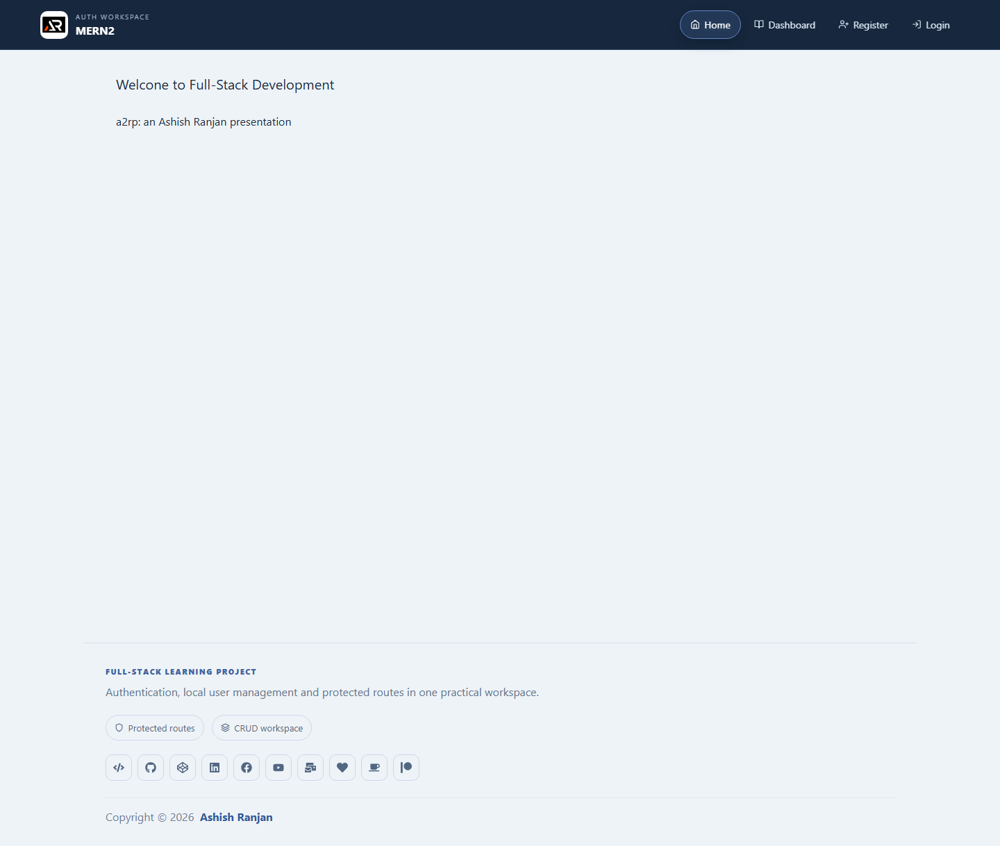

# MERN2 Auth Workspace

A MERN learning app with HttpOnly admin sessions and account-scoped user management. The React interface uses an Express and MongoDB API for registration, login, and user record CRUD.



## Features

- Admin registration and login with bcrypt password hashing
- HttpOnly, SameSite session cookie and server-verified protected routes
- MongoDB user records scoped to the signed-in admin
- Create, edit, delete, sort, and refresh user records
- Responsive React frontend with accessible form controls

## Requirements

- Node.js 18 or newer
- MongoDB running locally or a MongoDB connection string

## Run locally

In the repository root, copy `.env.example` to `.env`, set a private random `TOKEN_KEY` of at least 32 bytes, and set `MONGODB_URI` for your database. Then start the API:

```bash
npm ci
npm start
```

In another terminal, start the frontend:

```bash
cd frontend
npm ci
npm start
```

The API listens on port `1198` by default and the frontend uses `http://localhost:1198`. Set `REACT_APP_API_URL` to the API origin if it runs elsewhere. Set `CLIENT_ORIGIN` to the allowed frontend origin. For deployment, serve the frontend and API over HTTPS on the same site so the strict SameSite session cookie works as intended; a static GitHub Pages deployment alone cannot run the API.

## API

- `POST /api/v1/admin/register` — create an admin account
- `POST /api/v1/admin/login` — sign in and set the session cookie
- `POST /api/v1/admin/logout` — clear the session cookie
- `GET /api/v1/admin/verify` — verify the current session
- `GET /api/v1/user` — list the signed-in admin's user records
- `POST /api/v1/user/add` — create a user record
- `PUT /api/v1/user/:id` — update one of the signed-in admin's records
- `DELETE /api/v1/user/:id` — delete one of the signed-in admin's records
- `GET /health` — check API availability

User record routes require a valid session cookie and always scope reads and writes to that admin.

## Project structure

- `src/` — Express API, MongoDB models, controllers, routes, and authentication middleware
- `frontend/` — React application

## Links

- Portfolio: [ashishranjan.net](https://www.ashishranjan.net)
- GitHub: [a2rp](https://github.com/a2rp)
- CodePen: [ash1198](https://codepen.io/ash1198)
- LinkedIn: [Aashish Ranjan](https://www.linkedin.com/in/aashishranjan)

## Support

- [Support page](https://a2rp-donation-page.netlify.app/)
- [Buy Me a Coffee](https://buymeacoffee.com/a2rp)
- [Patreon](https://patreon.com/a2rp)
